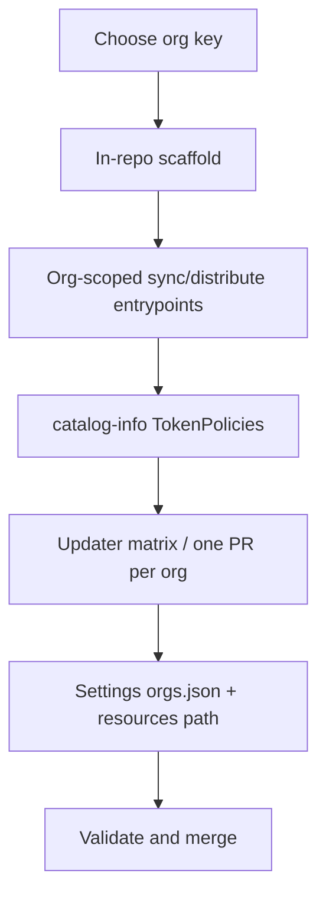

# Add a new org key

## Overview

You are scaffolding a new Backstage / control-plane **org key** under `config/<org-key>/` so that org can own its own workflow registry, active repositories, client triggers, and (when needed) sync/distribute TokenPolicies.

This is a **framework maintainer** procedure. It is not the same as registering one consumer repository — use [Registering resources](../onboarding/registering-a-repository.md) for that.



## Prerequisites

- Permission to change `elastic/oblt-aw` and `elastic/catalog-info` via reviewed pull requests.
- A short org key that matches existing style (`obs`, `docs`, `security`) and Backstage `metadata.labels.org` for that org’s github-repository RREs.
- Agreement on CODEOWNERS / approver teams for the new org’s paths and TokenPolicies.

## Steps

### 1. Scaffold the org in `elastic/oblt-aw`

Complete the mandatory checklist in [AGENTS.md — Adding a new org key](https://github.com/elastic/oblt-aw/blob/main/AGENTS.md) and [multi-org design §10](../architecture/multi-org-agentic-workflows.md#10-adding-a-new-org-key-implementation-checklist) in **one** change set:

| Step | What to change |
|------|----------------|
| Config | `config/<org-key>/workflow-registry.json` + `active-repositories.json` (both required for discovery) |
| Clients | `.github/remote-workflow-template/<org-key>/.github/workflows/trigger-<org-key>-aw-*.yml` |
| Orchestrators | `.github/workflows/<org-key>-aw-event-*.yml` (dashboard-audit-only is fine until routes exist; skip `aw-prelude` when the route list is empty) |
| CODEOWNERS | Rules for config, remote templates, `<org-key>-aw-*`, and `trigger-<org-key>-aw-*` |
| Onboard / docs | Issue form org dropdown, onboard agent prompt, and docs that list org keys |
| Prelude routes | `scripts/validate_aw_workflow_prelude.py` **derives** `<org-key>-aw-*` prefixes from discovered org dirs — do **not** hard-code org names there |
| Unit tests | `tests/unit/test_validate_aw_workflow_prelude.py` parametrizes over discovered org keys |

Do not invent a second checklist. If the tables above and AGENTS.md / §10 disagree, fix the docs so they match the scripts.

### 2. Add org-scoped sync and distribute entrypoints

Shared sync/distribute TokenPolicies cannot mix Backstage orgs in one selector: catalog-info pr-approval then asks every matched org’s teams to approve. Each org that needs fleet sync or client distribute gets its **own** workflow entrypoint and Vault role.

In `elastic/oblt-aw`, add (or wire) org-scoped wrappers, for example:

- `.github/workflows/distribute-client-workflow-<org-key>.yml`
- `.github/workflows/sync-control-plane-dashboard-<org-key>.yml`

Each entrypoint must use a distinct path so OIDC / Vault can bind a unique role. Companion work for the obs/security split: [oblt-aw#2491](https://github.com/elastic/oblt-aw/pull/2491).

Keep the thin shared orchestrators (`distribute-client-workflow.yml`, `sync-control-plane-dashboard.yml`) only if they still dispatch into the org-scoped jobs; do not reintroduce a single TokenPolicy that selects every org’s repositories.

### 3. Register catalog-info TokenPolicies (one PR per org)

In `elastic/catalog-info`, add TokenPolicy RREs for those entrypoints. Open **one catalog-info PR per org** so pr-approval stays with that org’s gatekeepers (for `org: obs`, see [pr-approval rules](https://github.com/elastic/catalog-info/blob/main/.buildkite/pr-approval/rules.yml) and [`@elastic/oblt-ephemeral-github-tokens`](https://github.com/orgs/elastic/teams/oblt-ephemeral-github-tokens)).

For each policy:

1. Set `bound_claims.workflow_ref` to the **org entrypoint path** with a ref wildcard, for example:

   ```text
   elastic/oblt-aw/.github/workflows/distribute-client-workflow-<org-key>.yml@*
   elastic/oblt-aw/.github/workflows/sync-control-plane-dashboard-<org-key>.yml@*
   ```

2. Set `spec.implementation.metadata.name` to `token-policy-{hash}`, where `{hash}` is the first **12** lowercase hex characters of SHA-256 over the **workflow path only** (everything before `@`). Example:

   ```bash
   WORKFLOW_PATH='elastic/oblt-aw/.github/workflows/distribute-client-workflow-<org-key>.yml'
   printf '%s' "$WORKFLOW_PATH" | shasum -a 256 | awk '{print substr($1, 1, 12)}'
   ```

3. Limit the `selector` to repositories under that Backstage org (for example files under `resources/github/engineering/<org-key>/`). Do not mix orgs in one selector.

4. Grant only the `additional_permissions` those workflows need (distribute typically needs contents / pull requests / workflows write; sync typically needs contents read and issues write — confirm against the live workflow YAML).

Example Vault role names for the obs/security split (path → role):

| Entrypoint path | Role name |
|-----------------|-----------|
| `…/distribute-client-workflow-obs.yml` | `token-policy-b30d4481761c` |
| `…/sync-control-plane-dashboard-obs.yml` | `token-policy-a95a5021fec0` |
| `…/distribute-client-workflow-security.yml` | `token-policy-63c1b5b6691c` |
| `…/sync-control-plane-dashboard-security.yml` | `token-policy-16edac196fcc` |

Catalog examples: [catalog-info#4972](https://github.com/elastic/catalog-info/pull/4972) (obs) and [catalog-info#4981](https://github.com/elastic/catalog-info/pull/4981) (security).

### 4. Extend the TokenPolicy repository updater

The weekly updater in `elastic/catalog-info` (`.github/scripts/update-token-policy-obs-repositories/` and `.github/workflows/update-token-policy-obs-repositories.yaml`):

- Rebuilds selectors from `resources/github/engineering/<org>/` via each RRE’s `repository:` field.
- Accepts `--org <org-key>` so CI can open **one sync PR per org**.
- Uses a workflow `strategy.matrix.org` list — add the new org key there and to the script’s policy table when you add the YAML files.

Until the new org’s policy files exist on `main`, a matrix job for that org will fail when it tries to open missing paths. Land the catalog policies before relying on the scheduled run, or temporarily keep the matrix without the new key until those files merge.

### 5. Onboard the org in `elastic/observability-github-settings`

Settings IaC is org-separated under `resources/<org-key>/<resource-type>/<repo>/` so CODEOWNERS can keep Obs out of other orgs’ reviews (and the reverse). Layout and generator details: [observability-github-settings CONTRIBUTING — Organization layout](https://github.com/elastic/observability-github-settings/blob/main/CONTRIBUTING.md#organization-layout) (meta: [observability-robots#5395](https://github.com/elastic/observability-robots/issues/5395)).

When the org is new to that repo:

1. Register a settings TokenPolicy in `elastic/catalog-info` (same permission shape as `token-policy-observability-github-settings.yaml`, selectors limited to that org).
2. Add the org to [`orgs.json`](https://github.com/elastic/observability-github-settings/blob/main/orgs.json) (`default-owner`, `token-policy`, `catalog-info-file`).
3. Create stacks under `resources/<org-key>/…` as consumers onboard (branch-protections, general, …).

Until `docs` / `security` appear in `orgs.json`, consumer onboarding for those orgs still uses the paths and owners that repo currently supports—confirm against `main` before opening PRs.

### 6. Validate

From `elastic/oblt-aw`:

```bash
pre-commit run --files <touched-paths>
python scripts/validate_aw_workflow_prelude.py
pytest tests/unit/test_validate_aw_workflow_prelude.py
```

From `elastic/catalog-info` (local check of role names):

```bash
# Confirm metadata.name matches sha256(entrypoint path)[:12] for each new policy
```

Merge order that keeps minting and approval sane:

1. Org-scoped entrypoints in `oblt-aw` (or the same train as catalog, if policies already point at those paths).
2. Catalog TokenPolicies for that org (separate PR from other orgs), including the settings apply policy when the org is new to settings IaC.
3. `orgs.json` + first `resources/<org-key>/…` stacks in observability-github-settings.
4. Updater matrix entry for the org once the sync/distribute policy files are on `main`.

### 7. First consumers

After the org scaffold exists, register repositories with [Registering resources](../onboarding/registering-a-repository.md) (consumer TokenPolicies for `trigger-<org-key>-aw-*.yml@*`, settings under `resources/<org-key>/…`, then `active-repositories.json`). Do not fold the first consumer registration into the org-scaffold PR unless you intentionally want one large review.

## Notes and deferrals

- **Docs org** — Same sync/distribute TokenPolicy pattern applies when Backstage labels for `config/docs` consumers are aligned. Until then, treat docs fleet TokenPolicies as deferred (same callout as the obs/security catalog split).
- **Shared common workflows** — Opting an org into `config/common` is a separate admin step: [Opt in or out of agentic workflows from other orgs](opt-in-common-services.md).

## See also

- [AGENTS.md — Adding a new org key](https://github.com/elastic/oblt-aw/blob/main/AGENTS.md)
- [distribute-client-workflow](../operations/distribute-client-workflow.md)
- [Multi-organization agentic workflows §10](../architecture/multi-org-agentic-workflows.md#10-adding-a-new-org-key-implementation-checklist)
- [observability-github-settings CONTRIBUTING](https://github.com/elastic/observability-github-settings/blob/main/CONTRIBUTING.md#organization-layout) — `resources/<org>/…` and `orgs.json`
- [Registering resources](../onboarding/registering-a-repository.md) — one consumer repository
- [sync-control-plane-dashboard](../workflows/sync-control-plane-dashboard.md)
- [Use GitHub ephemeral tokens](use-gh-ephemeral-tokens.md) — framework and consumer TokenPolicies
