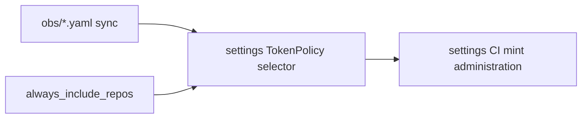

# Settings token-policy selector missing

## Symptom

An onboard settings PR in `elastic/observability-github-settings` fails during setup while validating GitHub token administration. Logs show a 404 on `/repos/elastic/<repo>/actions/permissions` and a message that the token cannot read repository settings / administration is required.

The consumer TokenPolicy (`token-policy-<repo>-oblt-aw`) may already exist. That policy is **not** the one settings Terraform uses.

## Cause

`observability-github-settings` mints an ephemeral token under `token-policy-observability-github-settings`. Its repository selector is rebuilt weekly from `resources/github/engineering/obs/*.yaml` in `elastic/catalog-info`. Repositories registered outside that tree (for example security or docs github-repository RREs) never appear unless they are listed in `always_include_repos` in the sync script.

## Fix

1. In `elastic/catalog-info`, add `'<repo>'` to `always_include_repos` in `.github/scripts/update-token-policy-obs-repositories/update_token_policy.py`.
2. Run `python .github/scripts/update-token-policy-obs-repositories/update_token_policy.py` so `token-policy-observability-github-settings.yaml` includes `elastic/<repo>`.
3. Merge that catalog change and wait for vault-realizer pickup, then re-run the settings PR checks.

Do not hand-edit only the YAML selector — the next weekly sync drops entries that are not discovered under `obs/` or listed in `always_include_repos`.

Onboard agents and maintainers: follow [Registering resources](../../onboarding/registering-a-repository.md) step **2e**.

## See also

- [Onboard a repository](../../user-guide/onboard-a-repository.md)
- [Registering resources](../../onboarding/registering-a-repository.md)
- [create-token or OIDC failures](create-token-or-oidc-failures.md)
