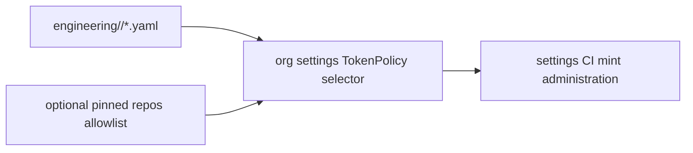

# Settings token-policy selector missing

## Symptom

An onboard settings PR in `elastic/observability-github-settings` fails during setup while validating GitHub token administration. Logs show a 404 on `/repos/elastic/<repo>/actions/permissions` and a message that the token cannot read repository settings / administration is required.

The consumer TokenPolicy (`token-policy-<repo>-oblt-aw`) may already exist. That policy is **not** the one settings Terraform uses.

## Cause

Each settings org mints under its own catalog TokenPolicy (see [`orgs.json`](https://github.com/elastic/observability-github-settings/blob/main/orgs.json) `token-policy` / `catalog-info-file`):

- `token-policy-observability-github-settings-obs.yaml` → `*-obs.yml` workflows
- `token-policy-observability-github-settings-security.yaml` → `*-security.yml` workflows

Selectors rebuild from `resources/github/engineering/<org>/` via `update_token_policy.py --org <org>`, unless that policy entry pins an explicit `repos` allowlist (security settings is pilot-pinned today). A repo missing from the mapped selector cannot mint `administration` for stacks under `resources/<org>/…`.

## Fix

1. In `elastic/catalog-info`, confirm a github-repository RRE exists under the mapped `resources/github/engineering/<org>/` tree (`docs` registrations use `obs` until labels match).
2. If the org settings policy pins `repos` in `.github/scripts/update-token-policy-obs-repositories/update_token_policy.py`, add `elastic/<repo>` to that list and keep every existing entry.
3. Run `python .github/scripts/update-token-policy-obs-repositories/update_token_policy.py --org <org>` so `token-policy-observability-github-settings-<org>.yaml` lists `elastic/<repo>`.
4. Merge that catalog change and wait for vault-realizer pickup, then re-run the settings PR checks.

Do not hand-edit only the YAML selector when a weekly sync or pinned allowlist would drop the entry. Do not invent an `obs/` RRE for a security-owned repository.

Onboard agents and maintainers: follow [Registering resources](../../onboarding/registering-a-repository.md) step **2e**.

## See also

- [Onboard a repository](../../user-guide/onboard-a-repository.md)
- [Registering resources](../../onboarding/registering-a-repository.md)
- [create-token or OIDC failures](create-token-or-oidc-failures.md)
- [observability-github-settings Organization layout](https://github.com/elastic/observability-github-settings/blob/main/CONTRIBUTING.md#organization-layout)
