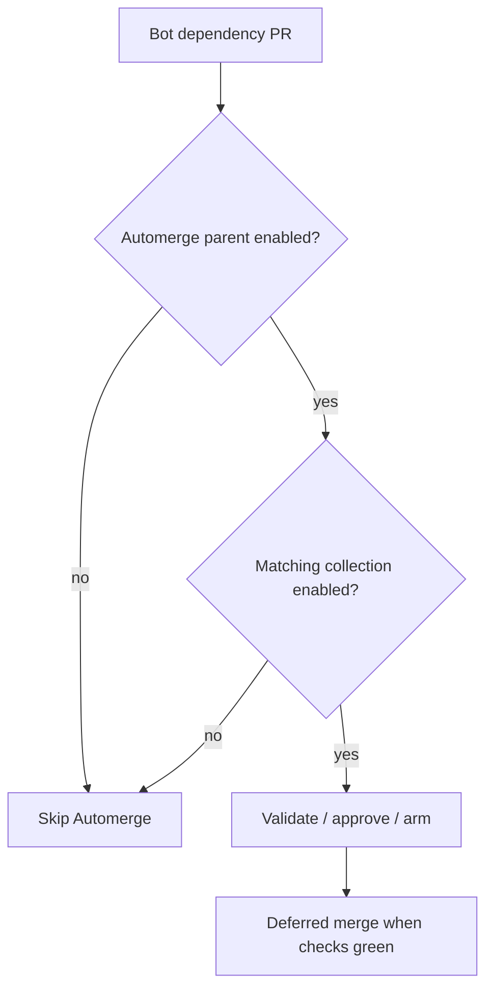

# Automerge dependency collections

## Overview

Automerge has two layers:

1. **Parent toggle:** turns Automerge on for the repository.
2. **Collection checkboxes:** choose which file collections Automerge may merge (dependency collections plus an optional catch-all).

This lets a team say: “We trust Automerge for these update types, but not for the rest.”

For non-dependency PRs (for example risk-labeled human or automation work), enable the **All files (non-dependency)** collection (`all-files`, off by default) and set consumer policy in `apm.yml` under `x-oblt-aw.<org>.workflows.automerge.policy`. Control Plane only turns features on or off; labels, authors, forks, and optional path allow/deny rules stay in the consumer repo. Step-by-step enablement and policy customization: [Non-dependency Automerge user journeys](automerge-user-journeys.md).

:::{image} ../images/control-plane-dashboard-checkboxes.png
:alt: Automerge parent checkbox with nested dependency collection checkboxes on the Control Plane dashboard
:screenshot:
:::

If a dependency collection is **enabled**, matching bot PRs can continue through the normal validation, approval, and merge flow (arm while required CI is pending; deferred merge on the frequent schedule profile). If a collection is **disabled**, those PRs stay unmerged; use the Automerge link on the Control Plane dashboard or the dependency-collection gate comment to review this catalogue and enable the right collection if you want it.



Technical details for eligibility, validation, approval, tokens, and merge behavior live in:

- [Automerge deferred (schedule)](../workflows/obs-aw-automerge-deferred.md)
- [Automerge routing](../routing/automerge-routing.md)
- [Automerge workflow](../workflows/obs-aw-automerge.md)

## What each dependency collection means

| Collection | What it covers | Representative files | Why enable it |
|------------|----------------|----------------------|---------------|
| All files (non-dependency) | Any changed paths when consumer automerge policy allows (optional `paths.allow` / `paths.deny`) | `**/*` | Opt-in catch-all for risk-labeled or otherwise policy-gated PRs outside dependency bots; prefer a specific collection when both match |
| APM CLI version | APM CLI pin updates for agent package install | `.apm.version`, `**/.apm.version`, `.apm-cli-pin/requirements.txt` | Keep the framework APM CLI pin current when Dependabot bumps `apm-cli` |
| oblt-cli version | oblt-cli pin updates | `.oblt-cli-version`, `**/.oblt-cli-version`, `.default-oblt-cli-version`, `**/.default-oblt-cli-version` | Useful when Updatecli (or similar) bumps only the oblt-cli version pin and you already trust that automation |
| GitHub Actions bumps | Version updates for GitHub Actions and composite actions | `.github/workflows/**`, `.github/actions/**`, `**/action.yml`, `**/action.yaml` | Keep CI actions current without hand-merging routine bumps |
| pre-commit hook updates | Dependency updates for pre-commit hooks | `.pre-commit-config.yaml` | Keep local and CI hook versions moving with low review overhead |
| Python dependencies | Python package and lockfile updates | `**/pyproject.toml`, `**/requirements.txt`, `**/requirements-*.txt`, `**/poetry.lock`, `**/Pipfile`, `**/Pipfile.lock` | Useful when Python bumps are routine and low risk for your repo |
| Go dependencies | Go module and sum updates | `go.mod`, `go.sum`, `**/go.mod`, `**/go.sum` | Good for teams that accept standard Go dependency refreshes automatically |
| Update beats | elastic-agent update-beats bumps | `NOTICE.txt`, `NOTICE-fips.txt`, `go.mod`, `go.sum`, `beats` | Helpful when update-beats changes are expected and well understood |
| Node dependencies | npm/yarn/pnpm manifest, lockfile, and JS bundled dist updates | `package.json`, `package-lock.json`, `yarn.lock`, `pnpm-lock.yaml`, `dist/**/*.cjs`, `dist/**/*.js`, `dist/**/*.js.map`, `dist/**/*.mjs`, `dist/licenses.txt`, `**/package.json`, `**/package-lock.json`, `**/yarn.lock`, `**/pnpm-lock.yaml`, `**/dist/**/*.cjs`, `**/dist/**/*.js`, `**/dist/**/*.js.map`, `**/dist/**/*.mjs`, `**/dist/licenses.txt` | Keep JavaScript dependency maintenance routine and predictable (including GitHub Actions that rebuild JS under `dist/`; not generic Go/goreleaser `dist/` trees) |
| Gradle dependencies | Gradle build, version catalog, and wrapper updates | `**/build.gradle`, `**/build.gradle.kts`, `**/gradle/*.versions.toml`, `**/gradle/wrapper/gradle-wrapper.properties`, `**/gradle/wrapper/gradle-wrapper.jar`, `**/gradlew`, `**/gradlew.bat` | Keep Gradle dependency and wrapper updates routine, including nested Android builds |
| Swift Package Manager dependencies | Swift package manifest and resolved dependency updates | `Package.swift`, `Package.resolved` (and `**/` variants) | Keep Swift package dependencies current in root and nested packages |
| CocoaPods dependencies | CocoaPods podspec, Podfile, and lockfile updates | `*.podspec`, `Podfile`, `Podfile.lock` (and `**/` variants) | Keep native iOS dependencies current without enabling other ecosystems |
| Terraform / OpenTofu | Terraform, OpenTofu, and Terragrunt dependency updates | `**/*.tf`, `**/*.tfvars`, `**/*.tfvars.json`, `**/.terraform.lock.hcl`, `**/terragrunt.hcl`, `**/.opentofu-version`, `**/.terraform-version`, `**/.terragrunt-version` | Useful for infrastructure repos that want safe, routine IaC refreshes merged automatically |
| Open Policy Agent | Rego policies plus OPA version and configuration updates | `**/*.rego`, `**/.opa-version`, `**/opa.yaml`, `**/opa.yml` | Keep policy code and OPA tooling current while preserving review control elsewhere |
| Updatecli compose / version | Updatecli compose policy catalog and tool version pin updates | `updatecli-compose.yaml`, `updatecli-compose.yml`, `**/updatecli-compose.yaml`, `**/updatecli-compose.yml`, `.updatecli-version`, `**/.updatecli-version` | Useful when Updatecli itself bumps policy image pins or its own tool version and you already trust those catalogs |
| VM / container images | CI runner, Docker/container, Compose, and snapshot-environment image-pin updates | `.buildkite/**`, `**/Dockerfile`, `**/Dockerfile.*`, `**/docker-compose.yml`, `**/docker-compose.yaml`, `testing/environments/snapshot.yml` | Handy when image-pin bumps are expected and you trust the matching automation path |
| Package version | `.package-version` bump automation | `.package-version`, `**/.package-version` | Useful for repos that treat version file bumps as routine automation |

When `vm-images` or `github-actions` covers every changed file, it takes precedence over `gradle`, `swiftpm`, and `cocoapods`. For example, `.buildkite/build.gradle` stays in `vm-images`, and `.github/actions/sdk/Package.swift` stays in `github-actions`. The infrastructure collection must be enabled; enabling only the mobile collection does not override it.

Collection ids and globs are defined in [`config/obs/automerge-dependency-collections.json`](https://github.com/elastic/oblt-aw/blob/main/config/obs/automerge-dependency-collections.json). Example entry:

```json
{
  "id": "github-actions",
  "description": "GitHub Actions and composite action version bumps",
  "file-glob": [
    ".github/workflows/**",
    ".github/actions/**",
    "**/action.yml",
    "**/action.yaml"
  ]
}
```

On the Control Plane dashboard, that collection appears as an indented checkbox under Automerge (`obs:automerge:github-actions`).

## Consumer policy (`apm.yml`) [consumer-policy-apmyml]

Optional under `x-oblt-aw.<org>.workflows.automerge.policy`:

```yaml
x-oblt-aw:
  version: 1
  obs:
    common: {}
    workflows:
      automerge:
        policy:
          trigger-labels:
            - my-team:merge-ready
          label-actors:
            allow:
              - nightshift-bot[bot]   # humans OK during beta; vault bot always added
          forks:
            mode: author-association   # or: disabled (default)
            author-associations:
              - MEMBER
              - OWNER
          authors:
            mode: author-association   # or: allow-list (default)
            allow-list: []             # used when mode is allow-list
            author-associations:
              - MEMBER
              - OWNER
          allowed-days-of-week:        # optional; omit or [] = all UTC days
            - monday
            - tuesday
            - wednesday
            - thursday
          paths:                       # optional; only applies to all-files
            allow:
              - docs/**
            deny:
              - "**/*.go"
              - helm/**
```

- **Trigger labels:** `oblt-aw/ai/merge-ready` is always effective. Listed labels are added; omitting merge-ready does not remove it. Who applies the label ([Dependency Review](dependency-review.md), a repository classifier / bridge, or a maintainer) is up to the repository unless `label-actors` is set.
- **Label actors:** Optional. When `label-actors` is set, Automerge reads the PR timeline and treats a trigger label as absent unless the latest `labeled` event was applied by an allowed actor. `elastic-vault-github-plugin-prod[bot]` is always included in the allow list when this gate is on. If the timeline cannot be read, verify and live merge fail closed. Omit `label-actors` to keep today’s presence-only behavior.
- **Authors:** Control-plane bots in [`allowed_pr_authors.json`](https://github.com/elastic/oblt-aw/blob/main/config/obs/allowed_pr_authors.json) are always allowed. `allow-list` adds logins; `author-association` allows non-bot authors whose GitHub `author_association` matches.
- **Forks:** Default `disabled` keeps same-repo only. `author-association` allows forks when association matches (for example Elastic employee forks with `MEMBER` / `OWNER`).
- **Allowed days of week:** Optional list of lowercase English weekday names (`monday` … `sunday`). Evaluated in **UTC** at merge time (and again on the deferred path). Omitted or empty means every day. Unknown names or a non-list value fail policy resolve closed. On a blocked day, Automerge can still approve and arm the PR; merge waits until an allowed UTC day.
- **Paths (all-files only):** Optional `paths.allow` and `paths.deny` globs. When `all-files` is the matched collection, every changed file (and any rename `previous_filename`) must match `allow` (if set) and none may match `deny` (`deny` wins). Globs support only `*` and `**` (same as collection `file-glob`); `?` and character classes are rejected. Omitted or empty lists leave path scope unrestricted. An invalid `paths` block (unknown keys, blank entries, unsupported syntax) fails closed. Specific dependency collections ignore this block.
- **Defaults when `policy` is omitted:** merge-ready only, no label-actor gate, forks disabled, authors allow-list with no extras (today’s bot path), no path restriction, all UTC weekdays allowed.
- **CODEOWNERS / merge queue:** Automerge still squash-merges over REST as the Vault app when `shared-token-policy` is set (bypass classic BP / rulesets). It does not enqueue into a merge queue.

See also [Local AI assets](local-ai-assets.md), [Non-dependency Automerge user journeys](automerge-user-journeys.md), and [Automerge routing](../routing/automerge-routing.md).

## Choosing what to enable

- Start with the **parent Automerge toggle**.
- Enable only the collections that match your repository.
- Leave **All files (non-dependency)** disabled until you have consumer policy and a trusted label path. Walk through enablement and customization in [Non-dependency Automerge user journeys](automerge-user-journeys.md).
- If you are unsure, leave a collection disabled until you are comfortable with the risk.
