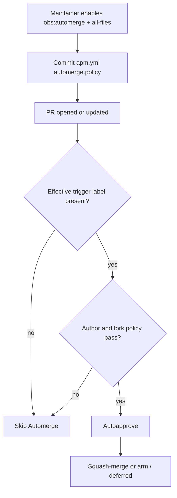

# Non-dependency Automerge user journeys

## Overview

Use these journeys when you want Automerge for **non-dependency** pull requests (human or automation work that is not a Dependabot-style collection bump). That path needs:

1. Parent Automerge and the **All files (non-dependency)** collection (`all-files`) on the Control Plane dashboard.
2. Consumer policy in root `apm.yml` under `x-oblt-aw.<org>.workflows.automerge.policy` (trigger labels, authors, forks).

Control Plane only turns features on or off. Labels, authors, and fork rules stay in your repository. Schema detail stays in [Choose Automerge dependency collections](automerge-services.md#consumer-policy-apmyml). Production pilot enablement is tracked in [#2571](https://github.com/elastic/oblt-aw/issues/2571).

Prefer a **specific** dependency collection when both that collection and `all-files` match the changed paths. Leave `all-files` off until policy and label ownership are agreed.



## Prerequisites

- The repository is onboarded and Automerge client triggers are installed ([Onboard a repository](onboard-a-repository.md)).
- You can open the Control Plane dashboard issue (`label:oblt-aw/dashboard`) ([Opt in or opt out of Automerge dependency collections](opt-in-opt-out.md)).
- You know your org key (for example `obs`) for the `x-oblt-aw.<org>` block ([Define local AI assets](local-ai-assets.md)).

## Who owns what

| Concern | Owner |
|---------|--------|
| Parent Automerge and collection checkboxes | You via Control Plane dashboard |
| `apm.yml` automerge policy (labels, authors, forks) | You in the consumer repository |
| Applying an effective trigger label | Maintainer, Dependency Review, or a repo classifier / bridge |
| Approve, merge, and deferred retry | Framework Automerge route |

## Journey 1 — Enable non-dependency Automerge

Goal: turn on `all-files` safely after policy is ready.

1. **Confirm Automerge clients exist** — Your repo should already have the pull-request and frequent-schedule Automerge triggers from onboarding. If Automerge is missing from the dashboard, finish onboarding first.
2. **Draft consumer policy before enabling `all-files`** — Add `workflows.automerge.policy` on the default branch (or the branch Automerge reads as the PR **base**). Start with trigger labels you trust; keep forks disabled unless you need trusted forks (later journeys).
3. **Enable the parent toggle** — On the Control Plane dashboard, check **Automerge** (`obs:automerge`).
4. **Enable All files (non-dependency)** — Check the indented **All files (non-dependency)** collection (`obs:automerge:all-files`). It is off by default.
5. **Wait for the next PR event** — Checkbox edits do not start Automerge by themselves. Open or label a PR, or update an existing one, to exercise the path.

Minimal policy (custom trigger label only):

```yaml
x-oblt-aw:
  version: 1
  obs:
    common: {}
    workflows:
      automerge:
        policy:
          trigger-labels:
            - my-team:merge-ready
```

`oblt-aw/ai/merge-ready` remains effective even when you omit it from the list.

## Journey 2 — Customize trigger labels

Goal: Automerge when your repo’s label is present, not only merge-ready.

1. **List extra labels under `policy.trigger-labels`** — Each listed label is added to the effective set. Omitting `oblt-aw/ai/merge-ready` does not remove it.
2. **Decide who applies the label** — For a first proof, a maintainer can add the label by hand. Later, Dependency Review or a repository classifier / bridge can apply the same label. Automerge does not invent labels; it only checks that at least one effective label is on the PR.
3. **Prove with a labeled PR** — Open a non-draft PR that should use `all-files`, apply one effective label, and confirm approve/merge (or arm when checks are still pending).

## Journey 3 — Customize authors

Goal: allow non-bot authors (or named extras) without opening Automerge to everyone.

Defaults when `policy` (or `authors`) is omitted: control-plane bots from [`allowed_pr_authors.json`](https://github.com/elastic/oblt-aw/blob/main/config/obs/allowed_pr_authors.json) only, plus an empty consumer allow-list.

### Allow-list extras

Use when a few logins should pass in addition to control-plane bots:

```yaml
policy:
  authors:
    mode: allow-list
    allow-list:
      - some-trusted-bot[bot]
```

### Author association

Use when same-repo (or allowed-fork) authors with a matching GitHub `author_association` should pass:

```yaml
policy:
  authors:
    mode: author-association
    author-associations:
      - MEMBER
      - OWNER
```

Control-plane bots remain allowed in both modes.

## Journey 4 — Customize forks (trusted contributor forks)

Goal: allow fork PRs only when association matches (for example Elastic employee forks).

1. **Keep the default while you prove same-repo** — Default `forks.mode` is `disabled` (same-repository PRs only).
2. **Switch to author-association when needed**:

```yaml
policy:
  forks:
    mode: author-association
    author-associations:
      - MEMBER
      - OWNER
```

3. **Expect fail-closed otherwise** — Forks with a non-matching association, or forks while mode is `disabled`, skip Automerge.

Fork PRs also need a token path that can approve and merge; see [Automerge routing](../routing/automerge-routing.md).

## Journey 5 — Prove a PR can Automerge

Goal: end-to-end happy path after enablement and policy are in place.

1. Open a **non-draft** PR whose changed paths fall through to `all-files` (not a more specific enabled collection you did not intend).
2. Ensure the author and fork rules in policy pass.
3. Apply at least one **effective** trigger label (`oblt-aw/ai/merge-ready` and/or a label from `trigger-labels`).
4. Let required checks run. Automerge may squash-merge immediately when GitHub’s merge API accepts the head, or **arm** the PR for deferred merge on the frequent schedule when checks are still pending.
5. Confirm success: approving review from Automerge, then merged or armed (bot comment with `obs-aw-automerge:armed`), not a dependency-collection skip comment.

## Journey 6 — Fail-closed (intentional skip)

Goal: confirm Automerge does **not** approve or merge when a gate fails.

Try one of these, then check Actions and PR comments:

| Situation | What you should see |
|-----------|---------------------|
| No effective trigger label | Verify skips; no approve/merge |
| Draft PR | Verify skips |
| Untrusted fork (`forks.mode: disabled` or association mismatch) | Verify skips |
| Parent Automerge off, or `all-files` off for a non-dependency PR | Collection gate skip comment (`obs-aw-automerge:dependency-collection-gate`); downstream jobs do not run |
| Stale head after new pushes | Merge path re-checks live head and labels; outdated armed markers do not merge the new head |

Fix the failing gate, then re-run by labeling, synchronizing, or reopening the PR.

## Outcome matrix

| Parent `obs:automerge` | `all-files` | Effective trigger label | Typical result for a non-dependency PR |
|------------------------|-------------|-------------------------|----------------------------------------|
| Off | any | any | Skip Automerge |
| On | Off | any | Collection gate skip (unless a specific enabled collection matches instead) |
| On | On | Missing | Verify skip (no approve/merge) |
| On | On | Present, checks pending | Approve, then arm / deferred merge |
| On | On | Present, merge API ready | Approve + squash-merge |

## Related

- [Choose Automerge dependency collections](automerge-services.md) — collection catalogue and full policy schema
- [Define local AI assets](local-ai-assets.md) — where `workflows.automerge.policy` lives
- [Opt in or opt out of Automerge dependency collections](opt-in-opt-out.md) — dashboard checkboxes
- [Automerge routing](../routing/automerge-routing.md) — events, gates, deferred merge
- [Automerge workflow](../workflows/obs-aw-automerge.md) — job-level contract
