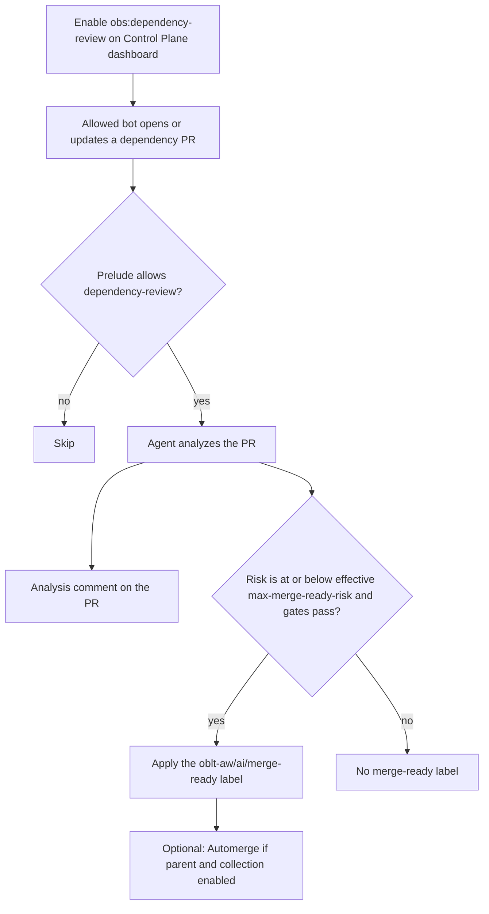

# Get Dependency Review on pull requests

## Overview

**Dependency Review** (`obs:dependency-review`) analyzes bot dependency pull requests in your repository. On each matching PR it can:

1. Post a structured **analysis comment** (changelog highlights, usage in this repo, compatibility, risk).
2. Apply the **`oblt-aw/ai/merge-ready`** label when overall risk is at or below the effective `max-merge-ready-risk` ceiling and the other merge-ready gates pass (default: **low-to-moderate**; optional consumer override: **moderate**).

You enable it from the Control Plane dashboard. The **framework** owns the route, agent lock, and labeling rules. The **control plane** only gates whether it runs for your repository.

Dependency Review does **not** merge the PR. Automerge (separate enablement) can use the merge-ready label later. See [Choose Automerge dependency collections](automerge-services.md).

## Prerequisites

- The repository is registered and Observability pull-request clients are installed (`trigger-obs-aw-pull-request.yml`). See [Onboard a repository](onboard-a-repository.md).
- **Dependency Review** (`obs:dependency-review`) is checked on the Control Plane dashboard. See [Enable or disable an agentic workflow](enable-a-new-workflow.md).
- Dependency bots that open PRs in your repo are on the framework allow list (see [When it runs](#when-it-runs)).

## Enable Dependency Review

1. Open the Control Plane dashboard issue (`label:oblt-aw/dashboard`).
2. Check **Dependency Review** (`obs:dependency-review`). GitHub saves on click.
3. Wait for the next matching bot PR (`opened`, new commits, or reopen). Checking the box does not run the agent by itself.

Optional: add consumer instructions under `x-oblt-aw` in root `apm.yml` so resolve can merge repo-specific guidance. See [Define local AI assets](local-ai-assets.md). Most teams start with the framework defaults only.

## When it runs

Dependency Review runs when **all** of these are true:

| Condition | Detail |
|-----------|--------|
| Event | `pull_request` with action `opened`, `synchronize`, or `reopened` |
| Author | PR author login is in [`config/obs/allowed_pr_authors.json`](https://github.com/elastic/oblt-aw/blob/main/config/obs/allowed_pr_authors.json) (for example `dependabot[bot]`, `renovate[bot]`, Elastic Renovate / Vault bots, `github-actions[bot]`, `mergify[bot]`) |
| Gate | Control Plane dashboard has `obs:dependency-review` enabled (`enabled-workflows` includes that id) |

Human-authored PRs are out of scope for this route. Dedicated same-repo E2E fixture PRs for other workflows may skip Dependency Review by design.

Client chain: `trigger-obs-aw-pull-request.yml` → `obs-aw-event-pull-request.yml` → `obs-aw-dependency-review.yml`.

## What you see on the PR

### Analysis comment

For a real dependency bump, the agent posts a comment titled **Dependency Update Analysis**. Typical sections:

- One-line **Summary** with overall risk
- Per-dependency checks (breaking changes, whether the change is testable on the PR, Actions commit verification / pin format when relevant)
- Changelog highlights, usage in this repository, compatibility notes
- **Labels Applied** (what was actually applied, or “No labels applied”)

If the PR has **no** dependency updates to review, the agent calls `noop` and does **not** post that analysis comment.

### `oblt-aw/ai/merge-ready` label

The agent applies the **`oblt-aw/ai/merge-ready`** label only when overall risk is at or below the effective `max-merge-ready-risk` ceiling and the framework gates pass (for example no breaking change that affects this repo, Actions pins not failing commit verification, production workflows that cannot be validated on the PR do not block incorrectly). Default ceiling is **low-to-moderate**; when a consumer sets `x-oblt-aw.<org-key>.workflows.dependency-review.policy.max-merge-ready-risk: moderate`, **moderate** can also receive the label. **high** never receives the label. Configure the ceiling in [Local AI assets → Dependency Review policy (`max-merge-ready-risk`)](local-ai-assets.md#dependency-review-policy-max-merge-ready-risk).

Missing upstream release notes alone must not raise risk above **low-to-moderate** or block the label when the other gates pass.

### Empty comment / retry note

If the agent run succeeds but produces no analysis `comment_id`, a control-plane job upserts a single PR comment (marker `obs-aw-dependency-review:notify-no-comment`) with the run URL and retry guidance. Push a new commit to the PR branch, or close and reopen the PR, so `pull_request` runs again.

## How it works with Automerge

| Piece | Role |
|-------|------|
| Dependency Review | Reviews the bot PR and may apply the `oblt-aw/ai/merge-ready` label |
| Automerge parent (`obs:automerge`) | Turns Automerge on for the repository |
| Automerge collection (for example `obs:automerge:github-actions`) | Allows that file collection to proceed |

Dependency Review can label a PR even when Automerge is off. Automerge still needs the parent toggle, a matching collection, and its own validation path. Collection meanings: [Choose Automerge dependency collections](automerge-services.md). Dashboard opt-in: [Opt in or opt out of Automerge dependency collections](opt-in-opt-out.md).

## Troubleshooting

| Symptom | What to check |
|---------|----------------|
| No Dependency Review job | Dashboard checkbox off, repo not onboarded, or PR author not on the allow list — [Workflows skipped or not running](../troubleshooting/common-problems/workflows-skipped-or-not-running.md) |
| Job skipped on a human PR | Expected: only allow-listed bot authors are routed |
| No analysis comment, only retry note | Empty safe outputs; push a commit or reopen the PR and re-check the Actions run |
| Analysis comment but no `oblt-aw/ai/merge-ready` label | Risk above the effective `max-merge-ready-risk` ceiling (default `low-to-moderate`), or a gate failed (breaking change, Actions verification, untestable production workflow impact). Read the comment’s Labels Applied section and policy docs: [Dependency Review policy (`max-merge-ready-risk`)](local-ai-assets.md#dependency-review-policy-max-merge-ready-risk) |
| `oblt-aw/ai/merge-ready` label present but PR not merged | Enable Automerge parent + matching collection; Dependency Review does not merge |

## References

- Workflow wrapper: [obs-aw-dependency-review](../workflows/obs-aw-dependency-review.md)
- Routing: [Dependency Review routing](../routing/dependency-review-routing.md)
- Catalog entry: [Agentic workflow catalog by outcome](../knowledge-base/agentic-workflows/by-outcome.md)
- Automerge collections: [Choose Automerge dependency collections](automerge-services.md)
- Local override contract: [Dependency Review policy (`max-merge-ready-risk`)](local-ai-assets.md#dependency-review-policy-max-merge-ready-risk)
