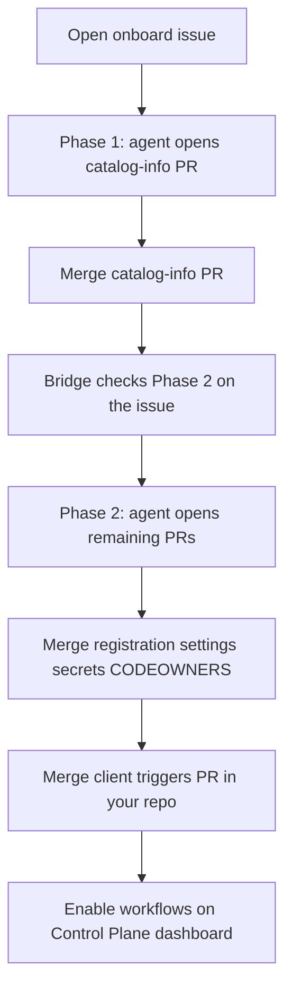

# Onboard a repository

## Overview

Use this guide when you want OBLT Agentic Workflows (`oblt-aw`) in a repository that is **not yet registered**. You open one issue in `elastic/oblt-aw`; automation opens the required pull requests in **two phases**; you merge them; then you enable agentic workflows from the Control Plane dashboard in your repository.



Technical registration detail for maintainers and agents: [Registering resources](../onboarding/registering-a-repository.md).

## Prerequisites

- The target repository is under the `elastic` GitHub organization.
- You have **write** access (or higher) on [elastic/oblt-aw](https://github.com/elastic/oblt-aw). Opening issues alone is not enough: GitHub only applies the form label when the creator has push access, and the agent role gate requires `write` / `maintain` / `admin`.
- You (or a teammate) can merge pull requests in [elastic/catalog-info](https://github.com/elastic/catalog-info), [elastic/oblt-aw](https://github.com/elastic/oblt-aw), [elastic/observability-github-settings](https://github.com/elastic/observability-github-settings), your consumer repository, and—when needed—[elastic/observability-github-secrets](https://github.com/elastic/observability-github-secrets).

## Steps

1. **Open the onboard issue** — Use the **[Onboard a repository](https://github.com/elastic/oblt-aw/issues/new?template=onboard-repository.yml)** form (or pick it from [New issue](https://github.com/elastic/oblt-aw/issues/new/choose)).

   :::{image} ../images/onboard-repository-issue-form.png
   :alt: Onboard a repository issue form preview with Repository and Organization key fields
   :screenshot:
   :::

2. **Fill the fields and keep the phase triggers**
   - **Phase triggers** — Leave the pre-filled task list as-is on submit (**Phase 1** checked, **Phase 2** unchecked). Merging the Phase 1 catalog-info PR normally checks Phase 2 for you; you can still check it manually.
   - **Repository** — `elastic/<repo>` (example: `elastic/my-repo`).
   - **Organization key** — `docs`, `obs`, or `security` (matches a `config/<org-key>/` folder in `elastic/oblt-aw`).

   ```text
   Repository:        elastic/my-repo
   Organization key:  obs
   Phase 1:           checked (runs on submit)
   Phase 2:           unchecked until catalog merges
   ```

3. **Submit** — The form applies the label `oblt-aw/onboard/repository`. That starts Phase 1 of the in-repo agent `gh-aw-onboard-repository` in `elastic/oblt-aw` only (this is **not** a consumer catalog / Control Plane dashboard agentic workflow). A 👀 reaction appears on the issue when the agent starts.

4. **Phase 1 — wait for the catalog PR** — The agent opens **only** the `elastic/catalog-info` pull request (consumer TokenPolicy, org-scoped sync/distribute/settings allowlists, and the onboard agent TokenPolicy selector for your repository). It comments on the issue with the PR link.

5. **Merge the catalog-info PR.** A catalog-info workflow (`oblt-aw-onboard-phase2-bridge`) checks **Phase 2** on this issue when that PR merges (title prefix `[oblt-aw][onboard]`, body must include `Related issue: …`). That edit starts the agent again (`issues` `edited`). You can also check Phase 2 yourself if the bridge did not run.

   If Phase 2 runs before TokenPolicies are live on the catalog-info default branch, the workflow **aborts** on the host: it unchecks Phase 2 and comments with the reason. Wait a few minutes, then check Phase 2 again.

6. **Phase 2 — wait for the remaining PRs** — The agent opens **separate, normal (non-draft) pull requests**, one concern per PR:

   | Order | Repository | What it changes |
   |------:|------------|-----------------|
   | 1 (Phase 1) | `elastic/catalog-info` | TokenPolicy for client `create-token`, mapped org-scoped sync/distribute **and** settings TokenPolicy allowlists, and onboard agent TokenPolicy selector |
   | 2 | `elastic/oblt-aw` | Entry in `config/<org-key>/active-repositories.json` |
   | 3 | `elastic/observability-github-settings` | Vault app in classic BP `pull_request_bypassers` under `resources/<settings-org>/branch-protections/<repo>/` (and merge-queue ruleset `bypass_actors` when present) |
   | 4 | `elastic/observability-github-secrets` | When org agentic workflow docs’ **Prerequisites** (or **API / Interface**) require consumer secrets; otherwise the agent notes “none” |
   | 5 | `elastic/<repo>` (consumer) | Add or update `.github/CODEOWNERS` for distributed trigger clients: `/.github/workflows/trigger-<org-key>-aw-* @elastic/<owning-team>` |
   | 6 | `elastic/<repo>` (consumer) | **When Renovate is enabled:** add a Renovate `packageRules` entry that disables updates for `.github/workflows/trigger-*-aw-*.yml` |

   ```mermaid
   flowchart LR
     C1[catalog-info Phase 1] --> C2[oblt-aw registration]
     C2 --> C3[settings]
     C3 --> C4[secrets if any]
     C4 --> C5[consumer CODEOWNERS]
     C5 --> C6[Renovate ignore if enabled]
   ```

7. **Merge manually in order** — Humans merge. Catalog-info is already merged before Phase 2. Then merge the **oblt-aw** registration PR, then settings (and secrets, if any) before relying on automerge or secret-backed agentic workflows in production. Merge the consumer **CODEOWNERS** PR (and Renovate ignore PR when applicable) before or with the first distribute trigger-client PR. Auto-merge of these PRs is **out of scope** for now.

   **If Renovate is enabled** in your repository, Phase 2 opens (or you confirm) a small Renovate config change that ignores distributed client triggers (append to existing `packageRules` when present):

   ```json
   {
     "packageRules": [
       {
         "description": "Distributed oblt-aw client triggers — pins owned by distribute-client-workflow",
         "enabled": false,
         "matchFileNames": [".github/workflows/trigger-*-aw-*.yml"]
       }
     ]
   }
   ```

   Without that rule, Renovate can pin-digest `elastic/oblt-aw` reusable workflows in `trigger-*-aw-*.yml` and fight distribute. Skip this when the repository does not use Renovate.

8. **After the oblt-aw registration PR merges to `main`** — Existing automation opens an agentic workflows triggers PR in your repository (`trigger-<org-key>-aw-*.yml`) via [distribute-client-workflow](../operations/distribute-client-workflow.md), and creates a **Control Plane dashboard** issue via [sync-control-plane-dashboard](../workflows/sync-control-plane-dashboard.md).

   If the consumer `CODEOWNERS` PR (and Renovate ignore PR, when applicable) from Phase 2 is still open, merge it before or with this trigger-client PR. Then merge the agentic workflows triggers PR. Confirm the Control Plane dashboard issue exists (title `[oblt-aw] Control Plane Dashboard`, GitHub label `oblt-aw/dashboard`). Sync pins it by default, so it usually appears at the top of the Issues list. If it is not pinned (for example when the repository already has three pinned issues), search with `label:oblt-aw/dashboard`.

   :::{image} ../images/pinned-control-plane-dashboard.png
   :alt: Control Plane Dashboard issue pinned at the top of the repository Issues page
   :screenshot:
   :::

   :::{image} ../images/find-control-plane-dashboard.png
   :alt: Issues search for label oblt-aw/dashboard showing the Control Plane Dashboard issue
   :screenshot:
   :::

   ```bash
   gh issue list --repo elastic/<repo> --label oblt-aw/dashboard --state open
   ```

9. **Enable or disable agentic workflows** — In your repository, open the Control Plane dashboard issue and check or uncheck the agentic workflows you want. GitHub saves on click. Agentic workflows apply on the next supported client trigger. See [Enable or disable an agentic workflow](enable-a-new-workflow.md). To run your own cron agents without owning locks, enable **Repo Scheduled** and follow [Run your own scheduled automations](run-scheduled-automations.md).

   :::{image} ../images/control-plane-dashboard-checkboxes.png
   :alt: Control Plane dashboard Enable/Disable checkboxes including Automerge dependency collections
   :screenshot:
   :::

## Troubleshooting

Full fixes live under [Troubleshooting](../troubleshooting/index.md). Quick links:

- **No agent comment / no PRs** (or retry after a partial run) — [Onboard agent no comment or PRs](../troubleshooting/common-problems/onboard-agent-no-comment-or-prs.md)
- **Phase 2 unchecked by the workflow** — Catalog-info from Phase 1 is not merged yet (or the onboard TokenPolicy selector still omits your repo). Merge that PR, then check Phase 2 again.
- **Registration merged too early** — [Registration before catalog TokenPolicy](../troubleshooting/common-problems/registration-before-catalog-token-policy.md)
- **Settings branch-protection PR fails token administration check** — [Settings token-policy selector missing](../troubleshooting/common-problems/settings-token-policy-selector-missing.md)
- **No install PR or Control Plane dashboard** — [Missing client template or Control Plane dashboard](../troubleshooting/common-problems/missing-client-template-or-dashboard.md)
- **Renovate changes `trigger-*-aw-*.yml`** — Confirm the Renovate `packageRules` ignore from Phase 2; see [Registering resources — step 5b](../onboarding/registering-a-repository.md#steps)
