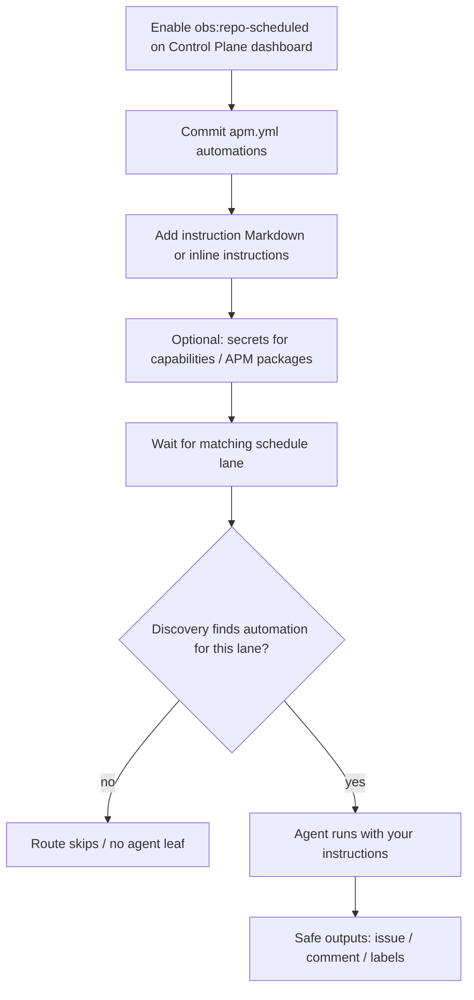

# Run your own scheduled automations

## Overview

Use **Repo Scheduled** (`obs:repo-scheduled`) when you want a cron-driven agent in your repository, but you do not want to own GH-AW compilation, lock files, or schedule client YAML.

You write the automation (instruction Markdown and optional APM skills/packages). `oblt-aw` owns the generic agentic workflow, schedule lanes (`daily` / `frequent` / `weekly`), dashboard gating, and allowlisted capabilities such as Buildkite logs.

This guide is the user journey. Contract detail lives in [Repo Scheduled](../workflows/obs-aw-repo-scheduled.md) ([#2197](https://github.com/elastic/oblt-aw/issues/2197)).



## Prerequisites

- The repository is registered and Observability schedule clients are installed (`trigger-obs-aw-schedule-daily.yml`, `trigger-obs-aw-schedule-frequent.yml`, `trigger-obs-aw-schedule-weekly.yml`). See [Onboard a repository](onboard-a-repository.md).
- You can edit the Control Plane dashboard issue (`label:oblt-aw/dashboard`) and commit to the default branch (or the branch the schedule checks out).
- You know which lane you need: `daily`, `frequent`, or `weekly` (see [Schedule lanes](#schedule-lanes)).

## Who owns what

| Concern | Owner |
|---------|--------|
| Dashboard enablement (`obs:repo-scheduled`) | You (checkbox) |
| Cron clients and lanes | Framework |
| Lock file / AW compilation | Framework |
| Which automations run | Your `apm.yml` `automations` list |
| What the agent does | Your instruction files or inline `instructions` |
| Optional Buildkite MCP (`buildkite-logs`) | Framework wiring + your `BUILDKITE_LOGS_API_TOKEN` secret |

## User journeys

### 1. First weekly automation (happy path)

Goal: one scheduled agent that creates an issue or comments when your instructions say so.

1. **Enable Repo Scheduled** — On the Control Plane dashboard, check **Repo Scheduled** (`obs:repo-scheduled`). Checking the box does not run the agent immediately; the next matching schedule wake applies gating. See [Enable or disable an agentic workflow](enable-a-new-workflow.md).

2. **Add root `apm.yml`** — Declare at least one automation under `x-oblt-aw.obs.workflows.repo-scheduled.automations`. Prefer an `instructions-file` under `.github/oblt-aw/scheduled/`. Every org block still needs `common` (it can be empty `{}`).

```yaml
x-oblt-aw:
  version: 1
  obs:
    common: {}
    workflows:
      repo-scheduled:
        automations:
          - id: weekly-nudge
            instructions-file: .github/oblt-aw/scheduled/weekly-nudge.md
            schedule-profiles: [weekly]
```

3. **Write the instruction file** — Put the agent brief in the Markdown body. Frontmatter is optional when `schedule-profiles` (and optional `id` / `capabilities`) are already set in `apm.yml`.

```markdown
---
schedule-profiles: [weekly]
---

Scan open pull requests idle for more than 14 days.
Add a short comment that asks for an update or a close decision.
Do not change repository files.
```

4. **Merge to the default branch** — Discovery reads the consumer checkout for that schedule run.

5. **Wait for the weekly lane** — `trigger-obs-aw-schedule-weekly.yml` (typical cron `0 6 * * 1` UTC). Or ask a maintainer to dispatch the schedule client with the weekly profile when your repo allows `workflow_dispatch`.

6. **Confirm in Actions** — Open the schedule client run in your repository. Expect prelude gating for `obs:repo-scheduled`, a discover step that lists your automation id, then an agent leaf for that id. Safe outputs are non-destructive (`create-issue`, `add-comment`, `add-labels`); there is no `contents: write`.

### 2. Buildkite build-error triage (capability + secret)

Goal: weekly triage of Buildkite failures, same pattern as consumer-owned AWs such as golang-crossbuild’s debug-build report, without a local lock file.

1. Complete [journey 1](#1-first-weekly-automation-happy-path) with `schedule-profiles: [weekly]` and `capabilities: [buildkite-logs]`.

```yaml
repo-scheduled:
  automations:
    - id: build-error-triage
      instructions-file: .github/oblt-aw/scheduled/build-error-triage.md
      schedule-profiles: [weekly]
      capabilities: [buildkite-logs]
```

2. **Add the repository secret** `BUILDKITE_LOGS_API_TOKEN` (same name as the status detective). The framework maps it to Buildkite MCP. See [Configure a GitHub secret](../admin-guide/configure-a-github-secret.md).

3. **Put triage guidance in the instruction body** — pipeline slug, lookback window, how to categorize failures, issue title/body conventions, labels such as `observablt-ci`, and when to open or skip an issue.

4. **If discovery fails closed** — An automation that lists `buildkite-logs` without the secret present fails that wake. Fix the secret, then wait for the next weekly run.

Copy-paste example: [consumer-apm.yml.example](../examples/consumer-apm.yml.example). Full field table: [Repo Scheduled](../workflows/obs-aw-repo-scheduled.md).

### 3. Nothing should run (fail-closed paths)

Use these checks when you expect silence:

| Situation | Expected result |
|-----------|-----------------|
| **Repo Scheduled** unchecked (or no dashboard) | Schedule route does not proceed for `obs:repo-scheduled` |
| No `automations` entry, or none whose `schedule-profiles` include the wake lane | Discovery finds no work; no agent leaf for your automation |
| `buildkite-logs` listed but `BUILDKITE_LOGS_API_TOKEN` missing | Discovery fails closed for that wake |
| Instruction only on a feature branch, schedule checks out default | Automation not seen until merged (or until the run uses that ref) |

Uncheck the dashboard box to stop all consumer-defined scheduled automations for the repository. To pause one automation only, remove or retarget its `schedule-profiles` / entry in `apm.yml`.

### 4. Migrate off a consumer-owned scheduled AW

If the repository already runs a local GH-AW (source `.md`, generated `.lock.yml`, compiler pin, and its own `schedule` trigger):

1. Enable **Repo Scheduled** and add an `apm.yml` automation that points at your prompt text (move it under `.github/oblt-aw/scheduled/` or use inline `instructions` with an `id`).
2. Keep the same lane and secrets (for Buildkite triage: `weekly` + `BUILDKITE_LOGS_API_TOKEN`).
3. Prove one green framework path (schedule or `workflow_dispatch`).
4. Remove the consumer lock, local cron workflow, and compile-check plumbing for that AW so you do not double-run.

## Schedule lanes

| Profile | Client trigger | Typical cron (UTC) | Use when |
|---------|----------------|--------------------|----------|
| `daily` | `trigger-obs-aw-schedule-daily.yml` | `0 6 * * *` | Once-per-day audits or summaries |
| `frequent` | `trigger-obs-aw-schedule-frequent.yml` | `*/15 * * * *` | Short-interval checks (use sparingly) |
| `weekly` | `trigger-obs-aw-schedule-weekly.yml` | `0 6 * * 1` | Weekly triage (for example build-error reports) |

List one or more profiles per automation. On each wake, only automations whose effective profiles include that lane run.

## Optional skills and packages

Repo Scheduled still goes through [resolve agentic assets](../workflows/aw-resolve-agentic-assets.md). You can:

- Put procedural guidance in the instruction Markdown (simplest).
- Install APM packages (skills, plugins, MCP servers) via top-level `dependencies.apm` in the same `apm.yml`. See [Define local AI assets](local-ai-assets.md).
- Use `obs.common` / other `workflows.<id>` blocks for shared setup or instructions on **other** agentic workflows; `workflows.repo-scheduled` is the override block for this route and holds the `automations` list.

Private GitHub APM packages need `ai-assets-token-policy` on the repo entry in `config/obs/active-repositories.json` (maintainer change).

## Example use cases (instruction content)

These are examples of what you put in the instruction body. The framework does not ship separate routes per use case; one generic AW runs whatever you declare.

| Use case | Typical lane | Typical capability |
|----------|--------------|--------------------|
| Buildkite build-error detect and triage | `weekly` | `buildkite-logs` |
| Build execution summary over a lookback window | `daily` or `weekly` | `buildkite-logs` when logs are required |
| Flaky-test detection notes or issue filing | `daily` or `weekly` | none, unless you need Buildkite MCP |

## What not to do

- Do **not** add consumer cron workflows, GH-AW sources, or lock files for Repo Scheduled.
- Do **not** rely on directory globbing; only automations listed under `x-oblt-aw.obs.workflows.repo-scheduled.automations` run.
- Do **not** expect `contents: write` or PR creation from this generic AW’s safe outputs.

## References

- [Repo Scheduled workflow](../workflows/obs-aw-repo-scheduled.md) — fields, capabilities, ownership, migration notes
- [Repo Scheduled routing](../routing/repo-scheduled-routing.md) — client → orchestrator → route gates
- [Define local AI assets](local-ai-assets.md) — `apm.yml` / APM packages for consumer customization
- [Enable or disable an agentic workflow](enable-a-new-workflow.md) — Control Plane dashboard
- [Example consumer `apm.yml`](../examples/consumer-apm.yml.example)
- Feature: [#2197](https://github.com/elastic/oblt-aw/issues/2197)
